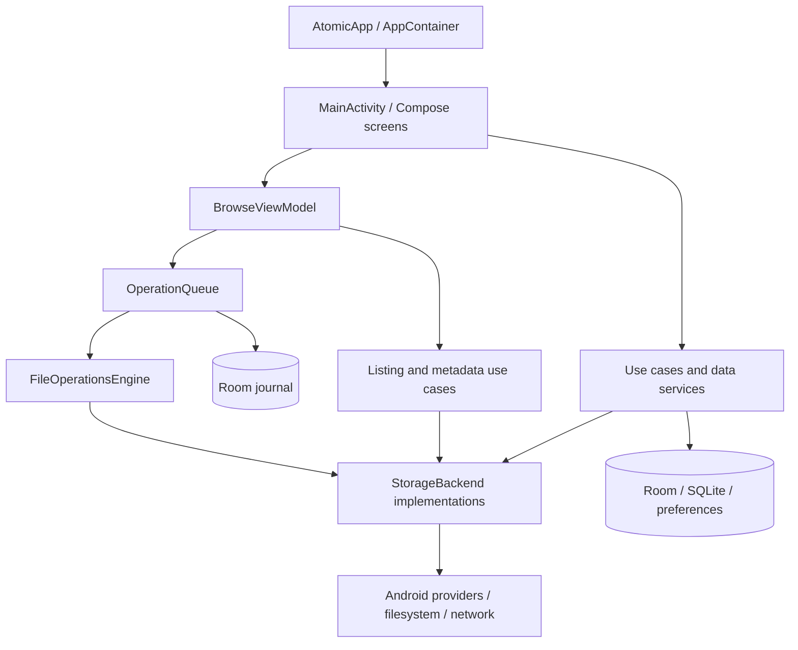

# Current architecture — verified source inventory

Audit date: 17 October 2026. Baseline: `7782660`. This inventory supersedes historical implementation claims in the original specification; those documents still describe product intent. Findings and implementation status live in [PROJECT_AUDIT](PROJECT_AUDIT.md) and [IMPLEMENTATION_PROGRESS](../roadmap/IMPLEMENTATION_PROGRESS.md).

## Product and implemented surfaces

Native Android file manager, API 27–36, Compose/Material 3 with the Atomic design system. Preserve beginner-friendly browsing, transfer bubbles, private files, preview, search, storage analysis and advanced tools. No web frontend or remote application server. Wi-Fi sharing runs a local HTTP server only when enabled.

Source directories under `app/src/main/kotlin/com/devbehindyou/atomicfilemanager/`:

| Boundary | Actual implementation |
|---|---|
| Composition root | `AtomicApp.kt`: manual `AppContainer`/`DefaultAppContainer`, lazy dependencies and process coroutine scope |
| Application shell | `MainActivity.kt`, `core/navigation/AtomicRoute.kt`: custom route stack; `ui/startup` loads saved settings on IO before themed app content, with retry/close failure UI; no active Hilt/NavHost graph |
| Presentation | `ui/screens`, `ui/components`, `ui/interaction`, `ui/shortcuts`; Browse uses `BrowseViewModel`, many other screens orchestrate work inside Compose |
| Files workspace | Mounted-volume shortcuts navigate the active BrowseViewModel, preserving its clipboard/history; type filtering runs off-main; shared row interactions render List or adaptive Grid from a persisted app setting |
| Adaptive presentation | Files top options wraps its measured content within window bounds; action-only bottom menu sections share AtomicCommandGrid; file fallback icons use metadata-only family classification and theme-aware colours while retaining actual preview pixels |
| Live tasks | Home/Files anchored popups observe OperationQueue and process-local Wi-Fi HTTP transfers; cancellation targets the existing job/request owner; the popup does not create or own work |
| Domain | `domain/model`, `domain/repository`, `domain/usecase`: storage IDs/results/capabilities, transfers, archive, trash, analysis, compare/sync, editing |
| Storage | `data/backend`: local File, SAF/USB, MediaStore, FTP/FTPS, SFTP, SMB, WebDAV, read-only Shizuku; selected by `StorageBackendSelector` |
| Operations | `data/operations/OperationQueue.kt`, `OperationRecovery.kt`; `service/FileOperationService.kt` observes process-owned execution |
| Persistence | Room schema v4: operation journal, search, trash, favourites/recents. Separate SQLiteOpenHelper stores for hidden files and transfer bubbles. SharedPreferences for settings/sort/credentials metadata |
| Search/categories | `data/search/RoomSearchIndex.kt`, `data/volume/PhoneFileIndex.kt`: periodic indexed search plus category walk; index does not replace freshness walk |
| Integration | `data/preview`, `data/share`, `data/vault`, `data/volume`, widget and shortcut packages |
| Preview ownership | Bounded PDF/DOCX/media/image helpers in `data/preview`; memory-owned editor sessions in presentation; provider video thumbnails use a distinct Coil fetcher instead of an in-process native frame retriever |

## Toolchain and dependencies

`settings.gradle.kts` includes `:app`, `:lint-rules`, `:benchmark`, plus included `build-logic`. Convention plugins set minSdk 27, compile/target SDK 36 and **Java 21**, despite older docs saying 17. Gradle wrapper 9.3.1; catalog pins AGP 9.1.1, Kotlin 2.2.10, KSP 2.3.12, Compose BOM 2026.04.01, coroutines 1.9.0, Room 2.7.2, Coil 3.3.0, Media3 1.8.0. Hilt 2.57.2 is declared but manual wiring is active.

Archive libraries: Commons Compress 1.28.0, XZ 1.10, Junrar 8.1.1, Zip4j 2.11.6. Networking: sshj 0.41.1, smbj 0.15.0; BouncyCastle artifacts deliberately aligned at 1.86. Vault uses Tink 1.23.0 and Android Keystore. Shizuku 13.1.5 is optional/read-only. Versions are repository facts, not claims that all are latest or vulnerability-free. No bulk upgrade is justified by this audit.

Tests: JUnit 5, JUnit 4/Vintage, Robolectric, coroutine test dispatchers, in-memory/fault-injecting storage, provider integration tests and device tests. Custom Lint plus ktlint and detekt enforce selected conventions. CI builds debug, R8 release and benchmark APKs. Connected API 34 tests/monkey are manual; macrobenchmark/profile generators exist but no measured profile is committed.

## Existing strengths and limitations

VerifiedFileTransfer stages ordinary copies, hashes source/output, protects in-process overwrite and deletes move sources only after verification. This is not a transaction spanning arbitrary providers or process death. The serial queue limits concurrent queued mutations, but rename/editor/share/other direct workflows do not all pass through it. Streaming local/provider listings exist; Lazy Compose lists and Coil already avoid needing a rendering rewrite. Search and category walks have separate freshness and cancellation responsibilities.

No general filesystem watcher, persistent analysis cache, provider-wide atomic compare-and-publish, complete per-file transaction journal or automatic device performance regression gate was verified. Symlinks, provider parent IDs, cancellation, external writers and interrupted publication require explicit tests rather than assumptions.

## Documentation reconciliation

README's first-build and September status sections remain explicitly historical. Current handover files now link this audit's results separately from earlier feature CI. `CODING_RULES.md` and `TECH_STACK.md` now describe Java21 and distinguish active dependencies from proposals. `PRIVACY.md` now describes user-directed networking and SharedPreferences; no universal redaction or crash-reporting implementation is claimed. `architecture/FILE_OPERATIONS.md` still includes design guarantees such as universal queue routing and recovery beyond actual code. `architecture/PERFORMANCE.md` describes targets, not recorded measurements. Preserve those specifications as intent/history and use this inventory plus current validation records for implementation facts.
